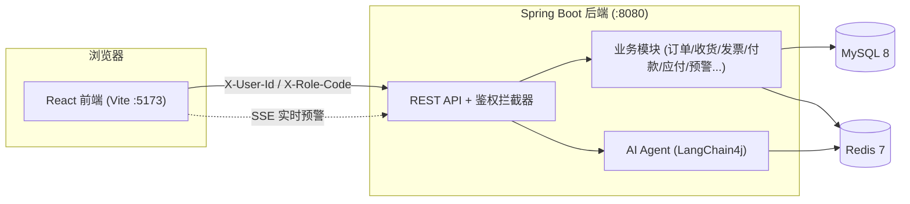

# YonErp · 采购经营工作台

> 模拟企业级 ERP 采购业务全流程的**前后端分离练习项目**，对标用友 BIP / YonBIP 设计风格。
> 覆盖「采购订单 → 收货 → 发票 → 付款 → 应付三单匹配 → 智能预警」完整闭环，并内置 AI Agent 智能问答与实时预警中心。

<p align="center">
  
</p>

<p align="center">
  
  
  
  
  
  
</p>

---

## 📖 目录

- [✨ 项目亮点](#-项目亮点)
- [🎯 功能特性](#-功能特性)
- [🏗️ 技术栈](#️-技术栈)
- [🧩 系统架构](#-系统架构)
- [🔐 角色与权限](#-角色与权限)
- [📦 功能模块详解](#-功能模块详解)
- [🚀 快速开始](#-快速开始)
- [👤 演示账号](#-演示账号)
- [📂 项目结构](#-项目结构)
- [🖼️ 截图画廊](#️-截图画廊)
- [❓ 常见问题 FAQ](#-常见问题-faq)
- [📄 许可证](#-许可证)

---

## ✨ 项目亮点

- **全流程采购闭环**：从采购订单创建、审批，到收货入库、采购发票、付款单，最后到应付三单匹配（订单/收货/发票），还原真实 ERP 业务流。
- **三单匹配引擎**：自研订单—收货—发票匹配规则，支持自动匹配、人工干预、暂估与回冲、差异处理工作台。
- **AI Agent 智能问答**：基于 LangChain4j 接入大模型，可基于当前业务数据自然语言提问（"本月待审批金额多少？"）。
- **实时预警中心**：基于 SSE 长连接实时推送预警，支持业务域筛选、指派/转办/处理、审计时间线。
- **多角色权限沙箱**：四类角色（管理员 / 采购员 / 采购经理 / 总监）数据隔离，一键切换角色体验不同视角。
- **BIP 风格工作台**：固定顶栏 + 左侧功能菜单 + 全局多页签导航（可切换/关闭/关闭其他），刷新不丢页签。

---

## 🎯 功能特性

| 模块 | 能力 |
|---|---|
| 采购订单 | 主从结构 CRUD、草稿/提交/审批状态机、订单详情、导入导出 |
| 审批流 | 两级审批（采购经理 → 总监），「我的待办」集中处理 |
| 收货 / 发票 / 付款 | 收货入库、采购发票（含红冲）、付款单，均支持按角色数据隔离 |
| 应付管理 | 应付对账、暂估与回冲、差异处理工作台、匹配规则配置 |
| AI Agent | 智能对话（LangChain4j）、预警中心（SSE）、预警规则配置 |
| 基础数据 | 供应商、物料、用户与角色维护 |
| 报表统计 | 多维度排行（供应商 / 采购员 / 物料 / 部门）、趋势图（Recharts） |
| 权限 | 四角色 RBAC、数据行级隔离、无密码简化登录（Redis 会话） |
| 工程化 | Docker Compose 一键启依赖、Redis 缓存/限流/防重、单号序列 |

---

## 🏗️ 技术栈

| 层 | 选型 |
|---|---|
| 前端 | React 18 + TypeScript + Vite + Ant Design 5 + TailwindCSS + Recharts + TanStack Query |
| 后端 | Java 17 + Spring Boot 3.2 + MyBatis-Plus + Spring AOP（角色注解） |
| AI | LangChain4j（大模型智能问答 / 工具调用） |
| 数据库 | MySQL 8 |
| 缓存 / 会话 | Redis 7（缓存、限流、防重、会话、SSE 通道） |
| 工程化 | Maven、Docker / Docker Compose、Swagger / SpringDoc |

---

## 🧩 系统架构



**关键设计**：
- **简化鉴权**：无密码登录，通过 `X-User-Id` / `X-Role-Code` 请求头识别用户与角色，会话写入 Redis（TTL 30 分钟，滑动续期）。
- **数据隔离**：采购员仅看本人单据，经理/总监看审批待办，管理员看全量。
- **实时推送**：预警中心通过 SSE 长连接推送，断线自动重连。

---

## 🔐 角色与权限

| 角色 | 代码 | 可访问 |
|---|---|---|
| 管理员 | `ADMIN` | 全部数据，可增删改；基础数据维护；用户与角色管理 |
| 采购员 | `BUYER` | 本人采购订单（新建/编辑/提交）、收货/发票/付款、报表（本人数据） |
| 采购经理 | `PURCHASE_MANAGER` | 一级审批「我的待办」、采购订单（只读）、报表 |
| 总监 | `DIRECTOR` | 二级审批「我的待办」、采购订单（只读）、报表 |

> 角色可在登录后通过右上角「当前角色」下拉**一键切换**，切换会自动清空页签与缓存，避免数据串号。

---

## 📦 功能模块详解

### 1. 工作台（首页）

汇总待办审批、预警摘要、快捷操作入口，不同角色看到的内容随权限自适应。

> 📷 **截图占位**：`assets/workbench.png` —— 工作台首页（管理员视角）

### 2. 采购订单

主从结构订单（表头 + 多行物料明细），支持草稿/提交/审批状态机、订单详情查看、Excel 导入。

> 📷 **截图占位**：`assets/orders.png` —— 采购订单列表 / 新建订单

### 3. 收货 · 发票 · 付款

- **收货入库**：到货登记，关联采购订单。
- **采购发票**：发票登记，支持红冲（负数发票）。
- **付款单**：付款申请与登记。

> 📷 **截图占位**：`assets/receipt-invoice-payment.png` —— 收货/发票/付款三页

### 4. 应付管理（三单匹配）

- **应付对账**：订单 / 收货 / 发票三方金额核对。
- **暂估与回冲**：月末暂估入账、回冲处理。
- **差异处理工作台**：匹配差异集中处理。
- **匹配规则配置**：业务自助配置匹配阈值与规则。

> 📷 **截图占位**：`assets/ap-match.png` —— 应付对账 / 匹配规则 / 差异处理

### 5. AI Agent

- **智能对话**：基于 LangChain4j，接入订单/库存/报表等工具，可自然语言问数。
- **预警中心**：SSE 实时推送预警，支持业务域筛选、指派/转办/处理、审计时间线。
- **预警规则配置**：阈值 / 级别 / 启停自助配置。

> 📷 **截图占位**：`assets/agent-chat.png` —— AI 智能对话
> 📷 **截图占位**：`assets/agent-alerts.png` —— 实时预警中心

### 6. 基础数据 & 报表统计

- **基础数据**：供应商、物料、用户与角色维护。
- **报表统计**：多维度排行 + 趋势图（Recharts）。

> 📷 **截图占位**：`assets/reports.png` —— 报表统计页

---

## 🚀 快速开始

### 前置条件

- JDK **17+**（Spring Boot 3 要求；项目实测用 Amazon Corretto 17）
- Maven 3.8+
- Node 18+
- Docker / Docker Desktop（用于一键启动 MySQL + Redis）

### 1. 启动依赖（MySQL + Redis）

```bash
docker compose up -d
```

> 若未安装 Docker，也可本地安装 MySQL 8 与 Redis 7，连接参数见 `backend/src/main/resources/application.yml`。

### 2. 启动后端（端口 8080）

> ⚠️ 必须使用 **JDK 17**，用 JDK 8 启动会编译失败。

```bash
cd backend
mvn spring-boot:run
```

或用项目自带脚本（需先配置好 JAVA_HOME 指向 JDK 17）：

```bash
./start-backend.bat      # Windows
```

### 3. 启动前端（端口 5173）

```bash
cd frontend
npm install
npm run dev
```

### 4. 访问

| 用途 | 地址 |
|---|---|
| 前端界面 | http://localhost:5173 |
| 后端接口 | http://localhost:8080/api |
| API 文档 (Swagger) | http://localhost:8080/swagger-ui.html |

---

## 👤 演示账号

本项目为**简化鉴权（无密码）**，在登录页直接「选择用户 + 选择角色」即可进入。

| 用户名 | 真实姓名 | 可选角色 | 说明 |
|---|---|---|---|
| `admin` | 系统管理员 | 管理员 | 全量数据，可增删改 |
| `buyer01` | 张采购 | 采购员 | 本人订单，可新建 |
| `buyer02` | 李采购 | 采购员 | 本人订单，可新建 |
| `manager01` | 王经理 | 采购经理 | 一级审批 |
| `director01` | 赵总监 | 总监 | 二级审批 |

> 登录页用户/角色下拉由后端 `GET /api/auth/users`、`GET /api/auth/roles` 动态加载。

---

## 📂 项目结构

```text
YonErp/
├── docker-compose.yml        # MySQL 8 + Redis 7 一键启动
├── backend/                  # Spring Boot 后端
│   └── src/main/java/com/yonerp/po/
│       ├── agent/            # AI Agent（LangChain4j 对话 + 预警扫描 + 工具）
│       ├── ap/               # 应付管理（对账/暂估/差异/匹配规则/匹配引擎）
│       ├── approval/         # 审批流
│       ├── base/             # 基础数据（供应商/物料/用户角色）
│       ├── importx/          # Excel 导入
│       ├── invoice/          # 采购发票
│       ├── order/            # 采购订单
│       ├── payment/          # 付款单
│       ├── receipt/          # 收货入库
│       ├── report/           # 报表统计
│       ├── security/         # 鉴权拦截器
│       └── tplus/            # 外部系统只读集成（示例）
├── frontend/                 # React 前端
│   └── src/
│       ├── api/              # axios 请求封装 + 各模块 API
│       ├── components/       # 通用组件（导入弹窗/搜索选择等）
│       ├── layouts/          # 主框架 + 全局多页签
│       ├── pages/            # 各业务页面
│       ├── router/           # 路由 + 角色守卫
│       └── store/            # zustand 状态（鉴权 / 页签）
├── docs/                     # 设计文档
└── scripts/                  # 辅助脚本
```

---

## 🖼️ 截图画廊

> 下面的图片占位等你补充。把截图按文件名放到**仓库根目录**的 `assets/` 文件夹即可自动显示。

| 截图 | 文件位置 | 说明 |
|---|---|---|
| 工作台首页 | `assets/workbench.png` | 管理员视角总览 |
| 采购订单 | `assets/orders.png` | 列表 / 新建 / 详情 |
| 收货发票付款 | `assets/receipt-invoice-payment.png` | 三业务页 |
| 应付三单匹配 | `assets/ap-match.png` | 对账 / 规则 / 差异 |
| AI 智能对话 | `assets/agent-chat.png` | 自然语言问数 |
| 实时预警中心 | `assets/agent-alerts.png` | SSE 推送预警 |
| 报表统计 | `assets/reports.png` | 多维排行 + 趋势 |

<p align="center">
  <!-- 📷 主视觉大图占位：assets/hero.png -->
  
</p>

---

## ❓ 常见问题 FAQ

**Q1：后端启动报 `Unsupported class file major version` / 编译失败？**
> 原因：用了 JDK 8 启动 Spring Boot 3 项目。解决：把 `JAVA_HOME` 指向 **JDK 17** 再启动。

**Q2：页面数据全是 0 / 空白？**
> 原因：后端或 Redis 没启动，接口拿不到数据。解决：先 `docker compose up -d` 起 MySQL+Redis，再 `mvn spring-boot:run` 起后端，最后刷新前端页面。

**Q3：端口被占用（8080 / 5173 / 3306 / 6379）？**
> 解决：关闭占用进程，或修改 `application.yml`、`vite.config.ts`、docker-compose 中的端口映射。

**Q4：切换用户后还显示上一个用户的数据？**
> 这是已知的鉴权缓存问题，已在代码中修复：登录 / 切换角色 / 退出时自动清空页签与 React Query 缓存。确保使用最新代码。

**Q5：刷新浏览器后页签丢失？**
> 不会。全局多页签状态通过 `zustand persist` 持久化到 localStorage，刷新可还原。

---

## 📄 许可证

本项目基于 **MIT License** 开源，仅用于学习与交流。

> ⚠️ 免责声明：本项目为个人练习项目，数据、账号、业务规则均为演示用途，与任何真实企业系统无关。
