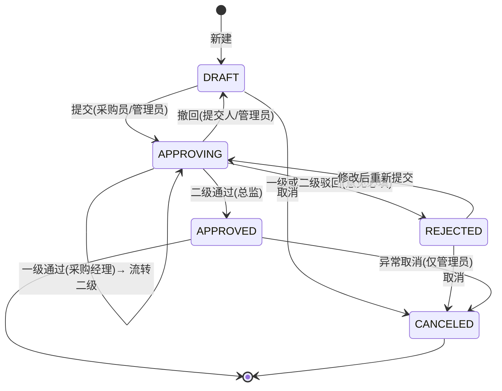

# 采购订单管理系统 · 完整技术方案

> 版本：v1.0 ｜ 状态：设计阶段（未编码） ｜ 目标：模拟企业级 ERP 采购流程，为学习用友 BIP / YonBIP 打基础

## 0. 文档约定与阅读方式

| 文档 | 内容 |
| --- | --- |
| `00-technical-solution.md`（本文） | 完整技术方案：架构、数据库、Redis、API、状态机、权限、异常处理、实施计划 |
| `01-database-schema.md` | 数据库详细设计：完整 DDL、索引、字典数据、初始化脚本 |
| `02-api-design.md` | API 详细设计：请求/响应 JSON 示例、错误码、权限矩阵 |
| `03-frontend-structure.md` | 前端结构：路由、页面、组件树、状态管理、字段布局 |
| `04-redis-design.md` | Redis 详细设计：Key 手册、TTL 策略、降级与运维 |

本文中的关键约定：

- **MySQL 是唯一真源**，Redis 只承担「缓存、会话、防重、锁、计数」四类职责，不承担业务最终状态。
- **状态变更只走动作接口**（`/api/orders/{id}/actions/{action}`），禁止用更新接口直接改状态。
- **金额一律 `BigDecimal`**，服务端重算，不信任前端传入金额。
- 金额精度：单价 `decimal(18,4)`，金额 `decimal(18,2)`，数量 `decimal(18,3)`，税率 `decimal(5,2)`；含税金额 = 数量 × 单价 × (1 + 税率/100)，四舍五入保留 2 位（`HALF_UP`）。

---

## 1. 系统架构设计

### 1.1 前后端分离架构

```
┌───────────────────────────────────────────────────────────────┐
│ 浏览器 React SPA（Vite + React 18 + TS + Ant Design 5）         │
│  布局层 Layout │ 路由守卫 │ 角色切换 │ TanStack Query 数据层      │
└───────────────────────────┬───────────────────────────────────┘
                            │ HTTP/JSON（CORS，端口 5173 → 8080）
                            │ 请求头：X-User-Id / Idempotency-Key
┌───────────────────────────▼───────────────────────────────────┐
│ Spring Boot 3.x 单体应用                                        │
│  Controller  →  Service（事务边界）  →  Mapper  →  MySQL 8      │
│       │              │                                          │
│       │              └──→ Redis 7（会话/缓存/防重/锁/计数）        │
│  拦截器：解析 X-User-Id → 查 Redis 会话 → 注入 CurrentUser        │
│  统一响应 / 全局异常 / 参数校验 / 审计字段填充                     │
└───────────────────────────────────────────────────────────────┘
```

契约约定：

| 项 | 约定 |
| --- | --- |
| 通信协议 | HTTP/1.1 + JSON，`Content-Type: application/json;charset=UTF-8` |
| 接口前缀 | `/api`，版本预留 `/api/v1`（MVP 直接用 `/api`） |
| 身份传递 | 请求头 `X-User-Id`（必填）+ `X-Role-Code`（当前角色，可省略则取默认角色） |
| 幂等 | 写类动作接口建议携带 `Idempotency-Key`（UUID），后端用 Redis `SET NX` 判定 |
| 时间格式 | `yyyy-MM-dd HH:mm:ss`（JSON），日期 `yyyy-MM-dd` |
| 金额 | 以字符串或数值传输，服务端统一转 `BigDecimal`，禁止 `double` |
| 跨域 | 后端 `CorsConfig` 放行 `http://localhost:5173`，允许 `X-User-Id`、`Idempotency-Key` 请求头 |
| 文档 | Springdoc OpenAPI，`/swagger-ui.html`、`/v3/api-docs` |

> 说明：本项目采用**简化鉴权**（无密码、无 JWT），通过"选择用户 + 切换角色"登录；但后端仍做真实角色与数据权限校验，越权一律 403。这既降低练习门槛，又保留了企业级权限校验的完整链路。

### 1.2 后端分层设计

| 层 | 包 | 职责 | 禁止事项 |
| --- | --- | --- | --- |
| Controller | `com.yonerp.po.*.controller` | 接收参数、校验入口、装配 VO、返回 `Result<T>` | 不写业务逻辑、不直接操作 Mapper |
| Service | `com.yonerp.po.*.service`（+ `impl`） | 业务规则、状态机、事务边界、缓存与锁编排 | 不感知 HTTP（不注入 `HttpServletRequest`） |
| Repository（Mapper） | `com.yonerp.po.*.mapper` | 数据访问：MyBatis-Plus `BaseMapper` + XML 复杂查询 | 不写业务判断 |
| Entity / DTO / VO | `*.entity` `*.dto` `*.vo` | 数据库实体 / 入参 / 出参 | Entity 不外泄给前端 |
| Common | `common` | `Result`、异常体系、错误码、分页封装、审计填充、常量 | — |
| Config | `config` | Redis、WebMvc、CORS、MyBatis 分页插件、OpenAPI | — |
| Security | `security` | Redis 会话、`CurrentUser` 上下文、`@RequireRole`、数据权限工具 | — |

调用链示例（提交审批）：

```
OrderController.submit(id, cmd)
   └─> OrderService.submit(id, cmd)              @Transactional
         ├─> PermissionChecker.checkOwner(...)   数据权限
         ├─> OrderStateMachine.validate(DRAFT→APPROVING)
         ├─> LockService.acquire("po:lock:action:{id}:submit")   Redis 幂等锁
         ├─> OrderMapper / OrderItemMapper       重算金额、写主表
         ├─> ApprovalService.initTasks(orderId)  生成两级审批任务
         ├─> ApprovalLogMapper.insert            写流水
         └─> CacheService.evictReportAndBadge()  事务提交后清缓存
```

审计字段（`create_by/create_time/update_by/update_time`）由 MyBatis-Plus `MetaObjectHandler` 统一注入，操作人从 `CurrentUser`（Redis 会话解析得到）读取，业务代码不手写。

### 1.3 Redis 在架构中的位置与职责

Redis 位于 **Service 层与 MySQL 之间**，是"旁路"（Cache-Aside）而非"主链路"：

```
Service ──读──> Redis（命中直接返回）
   │            未命中 ↓
   └──读──> MySQL ──回写 Redis
Service ──写──> MySQL ──(事务提交后)──> 删 Redis
```

四类职责（详见第 3 章）：

| 职责 | 典型场景 | 可丢失性 |
| --- | --- | --- |
| 会话与权限上下文 | 当前用户、当前角色、权限快照 | 可丢，丢失后重新登录/重查 DB |
| 基础数据与字典缓存 | 供应商、物料、状态字典 | 可丢，回源 MySQL |
| 统计结果缓存 | 按状态/按时间统计、待办角标 | 可丢，回源重算 |
| 防重、限流、锁、序列 | 幂等 token、接口限流、审批互斥锁、单号序列 | 可丢，Redis 失效时降级为 DB 约束兜底 |

---

## 2. 数据库设计

### 2.1 表清单与关系

```
sys_role ──< sys_user_role >── sys_user ──< po_order >── base_supplier
                                  │            │
                                  │            └──< po_order_item >── base_material
                                  │            │
                                  │            ├──< po_approval_task
                                  │            └──< po_approval_log
                                  └──(buyer_id)
sys_dict（独立字典表，无外键，按 dict_type 分组）
```

| 表名 | 说明 | 关键关系 |
| --- | --- | --- |
| `sys_user` | 用户 | `buyer_id` → `sys_user.id` |
| `sys_role` | 角色（4 个内置） | 经 `sys_user_role` 多对多 |
| `sys_user_role` | 用户-角色关联 | 联合唯一 `(user_id, role_id)` |
| `sys_dict` | 基础字典（状态、币种、单位等） | 无外键，逻辑关联 |
| `base_supplier` | 供应商 | `po_order.supplier_id` |
| `base_material` | 物料 | `po_order_item.material_id` |
| `po_order` | 采购订单主表 | 一对多明细、任务、流水 |
| `po_order_item` | 采购订单明细 | `order_id` → `po_order.id` |
| `po_approval_task` | 审批任务（当前节点待办） | `order_id` → `po_order.id` |
| `po_approval_log` | 审批流水（历史留痕） | `order_id` → `po_order.id` |

### 2.2 `sys_user` 用户表

| 字段 | 类型 | 必填 | 说明 | 键 |
| --- | --- | --- | --- | --- |
| `id` | bigint | 是 | 主键，雪花/自增 | PK |
| `username` | varchar(64) | 是 | 登录名（演示用唯一标识） | UK |
| `real_name` | varchar(64) | 是 | 姓名 | |
| `dept_id` | bigint | 否 | 所属部门（简化，关联 `sys_dict`） | |
| `mobile` | varchar(20) | 否 | 手机号 | |
| `email` | varchar(64) | 否 | 邮箱 | |
| `status` | tinyint | 是 | 1 启用 / 0 停用，默认 1 | |
| `create_by` / `create_time` | bigint / datetime | 是 | 审计 | |
| `update_by` / `update_time` | bigint / datetime | 否 | 审计 | |
| `deleted` | tinyint | 是 | 逻辑删除，默认 0 | |

### 2.3 `sys_role` 角色表

| 字段 | 类型 | 必填 | 说明 | 键 |
| --- | --- | --- | --- | --- |
| `id` | bigint | 是 | 主键 | PK |
| `role_code` | varchar(32) | 是 | `ADMIN`/`BUYER`/`PURCHASE_MANAGER`/`DIRECTOR` | UK |
| `role_name` | varchar(64) | 是 | 管理员/采购员/采购经理/总监 | |
| `description` | varchar(255) | 否 | 角色说明 | |
| `sort` | int | 否 | 排序，默认 0 | |
| `deleted` | tinyint | 是 | 逻辑删除 | |

### 2.4 `sys_user_role` 用户角色关联表

| 字段 | 类型 | 必填 | 说明 | 键 |
| --- | --- | --- | --- | --- |
| `id` | bigint | 是 | 主键 | PK |
| `user_id` | bigint | 是 | 用户 ID | FK → `sys_user.id`，UK(user_id, role_id) |
| `role_id` | bigint | 是 | 角色 ID | FK → `sys_role.id` |

### 2.5 `sys_dict` 基础字典表

| 字段 | 类型 | 必填 | 说明 | 键 |
| --- | --- | --- | --- | --- |
| `id` | bigint | 是 | 主键 | PK |
| `dict_type` | varchar(32) | 是 | 字典类型：`order_status`/`currency`/`unit`/`dept`/`approval_node` | IDX |
| `dict_code` | varchar(32) | 是 | 字典码：`DRAFT`/`CNY`/`个` | UK(type, code) |
| `dict_name` | varchar(64) | 是 | 展示名：`草稿`/`人民币` | |
| `dict_value` | varchar(128) | 否 | 扩展值（如色值、排序辅助） | |
| `sort` | int | 否 | 排序 | |
| `remark` | varchar(255) | 否 | 备注 | |
| `deleted` | tinyint | 是 | 逻辑删除 | |

### 2.6 `base_supplier` 供应商表

| 字段 | 类型 | 必填 | 说明 | 键 |
| --- | --- | --- | --- | --- |
| `id` | bigint | 是 | 主键 | PK |
| `supplier_code` | varchar(32) | 是 | 供应商编码 | UK |
| `supplier_name` | varchar(128) | 是 | 供应商名称 | IDX |
| `contact_name` | varchar(64) | 否 | 联系人 | |
| `contact_phone` | varchar(20) | 否 | 联系电话 | |
| `address` | varchar(255) | 否 | 地址 | |
| `status` | tinyint | 是 | 1 启用 / 0 停用 | |
| `deleted` | tinyint | 是 | 逻辑删除 | |
| 审计字段 | — | 是 | 同 2.2 | |

### 2.7 `base_material` 物料表

| 字段 | 类型 | 必填 | 说明 | 键 |
| --- | --- | --- | --- | --- |
| `id` | bigint | 是 | 主键 | PK |
| `material_code` | varchar(32) | 是 | 物料编码 | UK |
| `material_name` | varchar(128) | 是 | 物料名称 | IDX |
| `spec` | varchar(128) | 否 | 规格型号 | |
| `unit` | varchar(16) | 是 | 计量单位（个/台/千克/米） | |
| `category` | varchar(64) | 否 | 物料分类 | |
| `ref_price` | decimal(18,4) | 否 | 参考单价（下单时自动带出，可改） | |
| `tax_rate` | decimal(5,2) | 否 | 默认税率，默认 13.00 | |
| `status` | tinyint | 是 | 1 启用 / 0 停用 | |
| `deleted` | tinyint | 是 | 逻辑删除 | |
| 审计字段 | — | 是 | 同 2.2 | |

### 2.8 `po_order` 采购订单主表

| 字段 | 类型 | 必填 | 说明 | 键 |
| --- | --- | --- | --- | --- |
| `id` | bigint | 是 | 主键 | PK |
| `order_no` | varchar(32) | 是 | 订单编号 `PO202610130001` | UK |
| `title` | varchar(128) | 是 | 订单标题/事由 | |
| `supplier_id` | bigint | 是 | 供应商 | FK → `base_supplier.id`，IDX |
| `buyer_id` | bigint | 是 | 采购员（创建人） | FK → `sys_user.id`，IDX |
| `dept_id` | bigint | 否 | 采购部门 | |
| `currency` | varchar(8) | 是 | 币种，默认 `CNY` | |
| `order_date` | date | 是 | 订单日期 | IDX |
| `expect_date` | date | 否 | 期望到货日期 | |
| `total_qty` | decimal(18,3) | 是 | 明细数量汇总，服务端算 | |
| `total_amount` | decimal(18,2) | 是 | 含税金额合计，服务端算 | |
| `status` | varchar(20) | 是 | `DRAFT`/`APPROVING`/`APPROVED`/`REJECTED`/`CANCELED` | IDX |
| `current_node` | int | 否 | 当前审批节点序号（1 经理 / 2 总监），非审批态为 0 | |
| `submit_time` | datetime | 否 | 最近一次提交时间 | |
| `finish_time` | datetime | 否 | 审批完成时间 | |
| `version` | int | 是 | 乐观锁版本号，默认 0 | |
| `remark` | varchar(500) | 否 | 备注 | |
| 审计字段 | — | 是 | 同 2.2 | |
| `deleted` | tinyint | 是 | 逻辑删除，默认 0 | |

索引：`uk_order_no(order_no)`、`idx_status(status)`、`idx_order_date(order_date)`、`idx_supplier(supplier_id)`、`idx_buyer(buyer_id)`、`idx_status_date(status, order_date)`。

### 2.9 `po_order_item` 采购订单明细表

| 字段 | 类型 | 必填 | 说明 | 键 |
| --- | --- | --- | --- | --- |
| `id` | bigint | 是 | 主键 | PK |
| `order_id` | bigint | 是 | 所属订单 | FK → `po_order.id`，IDX |
| `line_no` | int | 是 | 行号（10/20/30…便于插入） | UK(order_id, line_no) |
| `material_id` | bigint | 是 | 物料 | FK → `base_material.id` |
| `material_name` | varchar(128) | 是 | 物料名称（冗余快照，防物料改名影响历史单据） | |
| `spec` | varchar(128) | 否 | 规格（冗余） | |
| `unit` | varchar(16) | 是 | 单位（冗余） | |
| `qty` | decimal(18,3) | 是 | 数量，> 0 | |
| `price` | decimal(18,4) | 是 | 单价（不含税），> 0 | |
| `tax_rate` | decimal(5,2) | 是 | 税率，默认取物料税率 | |
| `amount` | decimal(18,2) | 是 | 含税金额 = qty × price × (1+tax_rate/100) | |
| `remark` | varchar(255) | 否 | 行备注 | |
| `deleted` | tinyint | 是 | 逻辑删除 | |

### 2.10 `po_approval_task` 审批任务表

| 字段 | 类型 | 必填 | 说明 | 键 |
| --- | --- | --- | --- | --- |
| `id` | bigint | 是 | 主键 | PK |
| `order_id` | bigint | 是 | 订单 | FK → `po_order.id` |
| `node_seq` | int | 是 | 节点序号（1 采购经理 / 2 总监） | UK(order_id, node_seq) |
| `node_role` | varchar(32) | 是 | 该节点审批角色 | |
| `node_name` | varchar(64) | 是 | 节点名称，如"采购经理审批" | |
| `approver_id` | bigint | 否 | 实际审批人（审批后回填） | |
| `status` | varchar(20) | 是 | `WAITING`/`PENDING`/`APPROVED`/`REJECTED`/`INVALID` | IDX |
| `approve_time` | datetime | 否 | 审批时间 | |
| `opinion` | varchar(500) | 否 | 审批意见（驳回必填） | |
| `version` | int | 是 | 乐观锁 | |
| 审计字段 | — | 是 | 同 2.2 | |

### 2.11 `po_approval_log` 审批流水表

| 字段 | 类型 | 必填 | 说明 | 键 |
| --- | --- | --- | --- | --- |
| `id` | bigint | 是 | 主键 | PK |
| `order_id` | bigint | 是 | 订单 | FK → `po_order.id`，IDX |
| `node_seq` | int | 否 | 节点序号（非节点动作为 0） | |
| `node_role` | varchar(32) | 否 | 节点角色 | |
| `operator_id` | bigint | 是 | 操作人 | |
| `action` | varchar(32) | 是 | `SUBMIT`/`APPROVE`/`REJECT`/`WITHDRAW`/`CANCEL`/`RESUBMIT` | |
| `from_status` | varchar(20) | 否 | 变更前状态 | |
| `to_status` | varchar(20) | 否 | 变更后状态 | |
| `opinion` | varchar(500) | 否 | 意见 | |
| `operate_time` | datetime | 是 | 操作时间 | IDX |

---

## 3. Redis 设计

### 3.1 Key 总表

统一前缀 `po:`（purchase order），命名规范 `po:{域}:{对象}:{标识}`，全部小写 + 冒号分隔。

| 类别 | Key | 结构 | TTL | 写入时机 | 失效时机 |
| --- | --- | --- | --- | --- | --- |
| 会话 | `po:session:{userId}` | Hash（userId, username, realName, currentRole, loginTime） | 8h，访问续期 | 登录/切换角色 | 退出登录、管理员改角色 |
| 角色权限快照 | `po:session:{userId}:roles` | Set（roleCode…） | 8h | 登录、角色变更 | 管理员改角色时删除 |
| 用户列表（演示登录下拉） | `po:cache:user:list` | JSON Array | 30min | 首次查询 | 用户增删改 |
| 供应商 | `po:cache:supplier:{id}` | JSON | 30min | 首次查询 | 供应商增删改 |
| 供应商列表 | `po:cache:supplier:list` | JSON | 30min | 首次查询 | 供应商增删改 |
| 物料 | `po:cache:material:{id}` | JSON | 30min | 首次查询 | 物料增删改 |
| 物料列表 | `po:cache:material:list` | JSON | 30min | 首次查询 | 物料增删改 |
| 字典 | `po:cache:dict:{type}` | JSON | 2h，启动预热 | 首次查询/启动 | 字典变更 |
| 报表-按状态 | `po:report:status:{scope}:{paramsHash}` | JSON | 5min | 报表查询 | 任意订单写操作后清 `po:report:*` |
| 报表-按时间 | `po:report:time:{granularity}:{rangeHash}` | JSON | 5min | 报表查询 | 同上 |
| 待办角标 | `po:badge:todo:{roleCode}` | String(计数) | 2min | 菜单加载 | 审批任务状态变化 |
| 单号序列 | `po:seq:order:{yyyyMMdd}` | String(INCR) | 当日 +1 天 | 新建订单 | 自然过期（DB 唯一索引兜底） |
| 幂等 token | `po:idem:{key}` | String(NX) | 10s | 动作接口调用 | 完成或超时 |
| 动作互斥锁 | `po:lock:action:{orderId}:{action}` | String(NX) | 10s | 提交/撤回/取消 | 动作结束释放 |
| 审批互斥锁 | `po:lock:approve:{taskId}` | String(NX) | 15s | 审批动作 | 落库后释放 |
| 接口限流 | `po:rate:{userId}:{apiCode}` | String(INCR) | 60s（固定窗口） | 每次请求 | 窗口自然过期 |
| 超时提醒（可选） | `po:timeout:zset` | ZSET（member=orderId, score=到期时间戳） | — | 提交审批时写入 | 审批完成/撤回时移除 |

### 3.2 过期策略

- 会话 8h 并滑动续期（每次请求 `EXPIRE` 刷新）；角色快照与会话同生命周期。
- 基础数据 30min，字典 2h，**均附加 0~300s 随机抖动**，避免同时过期造成雪崩。
- 报表 5min（业务上容忍 5 分钟延迟），待办角标 2min。
- 锁类 Key TTL 必须大于业务最大耗时（10~15s），并且由 `finally` 释放，**释放时校验 value 防止误删他人锁**。
- 空结果缓存：查询为空时写入空占位（如 `"__NULL__"`），TTL 60s，防缓存穿透。

### 3.3 更新与失效策略

| 场景 | 策略 |
| --- | --- |
| 读（Cache-Aside） | 先读 Redis；未命中回源 MySQL 并回写；异常时降级直连 DB |
| 写基础数据 | 先更新 MySQL，事务提交后 `@CacheEvict` 删除对应 `po:cache:*`（**不做缓存更新**，避免并发脏写） |
| 写订单/审批 | 事务提交后删除 `po:report:*` 与 `po:badge:*` |
| 切换角色 | 覆写 `po:session:{userId}` 并刷新 TTL，前端 Zustand 同步 |
| 审批任务变更 | 删除对应角色 `po:badge:todo:*`、清理 `po:report:*`、从 `po:timeout:zset` 移除 |
| 批量清理 | 使用 `SCAN` + 前缀删除，**禁止生产使用 `KEYS`**（练习项目可用 `KEYS po:report:*` 简化） |

### 3.4 必须以 MySQL 为准的数据

| 数据 | Redis 中是否缓存 | 原因 |
| --- | --- | --- |
| 订单主表、明细 | **不缓存实体** | 状态频繁变更，缓存易与 DB 不一致；一致性优先于性能 |
| 审批任务、流水 | **不缓存** | 决定流程正确性，必须以 DB 为准；并发靠乐观锁 |
| 订单状态 | 不缓存 | 状态机唯一真源在 DB |
| 金额 | 不缓存 | 每次由服务端按明细重算落库 |
| 用户/角色/供应商/物料 | 缓存（30min） | 低频变更，可容忍短暂不一致 |
| 字典 | 缓存（2h） | 极少变更 |
| 统计报表 | 缓存（5min） | 可容忍延迟，命中率高 |
| 会话/锁/限流/序列 | Redis 为主 | 临时态数据，丢失可重建 |

**单号生成**：`INCR po:seq:order:{yyyyMMdd}` 取序号 → 拼 `PO + yyyyMMdd + 4 位序号`；Redis 不可用时回退为 DB `MAX(order_no)+1`；`order_no` 唯一索引兜底防重。

---

## 4. API 接口设计

### 4.1 通用约定

**统一响应体**

```json
{ "code": 0, "message": "success", "data": {}, "timestamp": 1760000000000 }
```

**分页响应体**：`data = { "records": [...], "total": 128, "pageNo": 1, "pageSize": 20 }`

**请求头**

| 头 | 必填 | 说明 |
| --- | --- | --- |
| `X-User-Id` | 是 | 当前用户 ID，拦截器据此解析 Redis 会话 |
| `X-Role-Code` | 否 | 当前角色，缺省取用户默认角色 |
| `Idempotency-Key` | 否（动作接口建议） | UUID，防重复提交 |

**错误码分段**：`0` 成功；`1xxx` 参数/校验；`2xxx` 业务规则；`3xxx` 权限；`4xxx` 并发/重复；`5xxx` 系统。

### 4.2 接口清单

#### 认证与会话

| 方法 | 路径 | 说明 | 权限 | Redis |
| --- | --- | --- | --- | --- |
| GET | `/api/auth/users` | 演示用户列表（登录下拉） | 匿名 | 缓存 30min |
| POST | `/api/auth/login` | 选用户登录，写入会话 | 匿名 | 写 `po:session:{userId}` |
| POST | `/api/auth/switch-role` | 切换当前角色 | 登录 | 覆写会话 |
| POST | `/api/auth/logout` | 退出 | 登录 | 删会话 |
| GET | `/api/auth/current` | 当前用户 + 角色 + 权限 | 登录 | 读会话 |

#### 基础数据

| 方法 | 路径 | 说明 | 权限 | Redis |
| --- | --- | --- | --- | --- |
| GET | `/api/suppliers` | 分页列表/下拉 | 登录 | 缓存列表 |
| GET | `/api/suppliers/{id}` | 详情 | 登录 | 缓存 |
| POST/PUT/DELETE | `/api/suppliers`（`/{id}`） | 增删改 | ADMIN | 清缓存 |
| GET | `/api/materials` | 分页列表/下拉 | 登录 | 缓存列表 |
| GET | `/api/materials/{id}` | 详情 | 登录 | 缓存 |
| POST/PUT/DELETE | `/api/materials`（`/{id}`） | 增删改 | ADMIN | 清缓存 |
| GET | `/api/dict/{type}` | 字典项 | 登录 | 缓存 2h |
| GET | `/api/users`、`POST/PUT/DELETE` | 用户管理 | ADMIN | 清 `po:cache:user:list` |
| GET | `/api/roles` | 角色列表 | ADMIN | 缓存 |
| PUT | `/api/users/{id}/roles` | 分配角色 | ADMIN | 清会话角色快照 |

#### 订单

| 方法 | 路径 | 说明 | 权限 | Redis |
| --- | --- | --- | --- | --- |
| GET | `/api/orders` | 分页列表（关键字/状态/日期区间/供应商/采购员） | 登录（BUYER 仅本人） | — |
| GET | `/api/orders/{id}` | 详情（含明细、审批任务、流水） | 登录（BUYER 仅本人） | — |
| POST | `/api/orders` | 新建草稿 | BUYER/ADMIN | `po:seq:order:{date}`；清报表缓存 |
| PUT | `/api/orders/{id}` | 编辑（仅 DRAFT/REJECTED，含明细整体保存） | BUYER(本人)/ADMIN | 清报表缓存 |
| DELETE | `/api/orders/{id}` | 删除（仅 DRAFT） | BUYER(本人)/ADMIN | 清报表缓存 |
| DELETE | `/api/orders/batch` | 批量删除（仅 DRAFT） | BUYER(本人)/ADMIN | 清报表缓存 |
| POST | `/api/orders/{id}/actions/submit` | 提交审批 | BUYER(本人)/ADMIN | **幂等 + 动作锁** |
| POST | `/api/orders/{id}/actions/withdraw` | 撤回 | BUYER(本人)/ADMIN | **动作锁** |
| POST | `/api/orders/{id}/actions/cancel` | 取消（原因必填） | BUYER(本人)/ADMIN | **动作锁** |
| POST | `/api/approvals/{taskId}/approve` | 审批通过 | 当前节点角色 | **幂等 + 审批锁 + 乐观锁** |
| POST | `/api/approvals/{taskId}/reject` | 审批驳回（意见必填） | 当前节点角色 | **同上** |
| GET | `/api/approvals/todo` | 我的待办列表 | PURCHASE_MANAGER/DIRECTOR | 角标计数缓存 |

#### 报表

| 方法 | 路径 | 说明 | 权限 | Redis |
| --- | --- | --- | --- | --- |
| GET | `/api/reports/summary` | 总单量/总金额/待审批数 | 登录 | 缓存 5min |
| GET | `/api/reports/by-status` | 按状态统计（饼图） | 登录 | 缓存 5min |
| GET | `/api/reports/by-time?granularity=month|day&from&to` | 按时间统计（柱状图） | 登录 | 缓存 5min |
| GET | `/api/reports/orders/export` | 订单列表视图导出（CSV/Excel，二期） | 登录 | 限流 |

### 4.3 关键接口详情

**POST `/api/orders`** 新建草稿

请求体：

```json
{
  "title": "2026 年 Q4 办公耗材采购",
  "supplierId": 1001,
  "currency": "CNY",
  "orderDate": "2026-10-13",
  "expectDate": "2026-10-25",
  "remark": "季度常规采购",
  "items": [
    { "lineNo": 10, "materialId": 2001, "qty": 50, "price": 12.5000, "taxRate": 13.00, "remark": "A4 复印纸" }
  ]
}
```

响应 `data`：`{ "id": 1, "orderNo": "PO202610130001", "status": "DRAFT", "totalQty": 50, "totalAmount": 706.25 }`

校验：`title/supplierId/orderDate` 必填；`items` 至少 1 行；`materialId` 必填且存在；`qty>0`、`price>0`、`taxRate ∈ [0,100]`；服务端重算 `amount` 与合计。

**POST `/api/orders/{id}/actions/submit`** 提交审批

请求体：`{ "remark": "请审批", "idempotencyKey": "uuid"（亦可放请求头） }`

逻辑顺序：解析会话 → 校验角色与归属 → 状态机校验 `DRAFT→APPROVING` → 幂等键 `SET po:idem:{key} NX EX 10`（重复则 4001）→ 动作锁 `po:lock:action:{id}:submit` → 重算金额 → 更新订单头（乐观锁 `version`）→ 生成两级审批任务（seq1 `PENDING`，seq2 `WAITING`）→ 写流水 → 提交后清 `po:report:*`、`po:badge:*` → 释放锁。

**POST `/api/approvals/{taskId}/approve`** 审批通过

请求体：`{ "opinion": "同意采购", "version": 0 }`

逻辑：校验当前用户角色 == 任务 `node_role` → 幂等 + `po:lock:approve:{taskId}` → 更新任务（乐观锁）→ 若存在下一节点则置为 `PENDING` 并更新 `po_order.current_node`；若为末节点则订单置 `APPROVED`、`finish_time` 落库 → 写流水 → 清缓存 → 释放锁。

**GET `/api/orders`** 列表查询

参数：`keyword`、`status`、`supplierId`、`buyerId`、`startDate`、`endDate`、`pageNo`(默认 1)、`pageSize`(默认 20)、`sortField`、`sortOrder`。
BUYER 角色强制附加 `buyerId = 当前用户`（后端覆盖，不信任前端入参）。

### 4.4 Redis 参与矩阵

| 场景 | 机制 | Key |
| --- | --- | --- |
| 会话校验 | 每次请求解析 `X-User-Id` → 读 Redis 会话 → 注入 `CurrentUser`；会话不存在则 3001 | `po:session:{userId}` |
| 防重复提交 | `Idempotency-Key` + `SET NX EX 10` | `po:idem:{key}` |
| 动作并发 | 同一订单同一动作互斥 | `po:lock:action:{orderId}:{action}` |
| 审批并发 | 同一任务互斥 + DB 乐观锁 | `po:lock:approve:{taskId}` |
| 接口限流 | 固定窗口计数（如导出/报表 60s/30 次） | `po:rate:{userId}:{apiCode}` |
| 单号生成 | `INCR` 当日序列 | `po:seq:order:{yyyyMMdd}` |
| 统计加速 | 结果缓存 5min | `po:report:*` |
| 角标 | 待办计数 | `po:badge:todo:{roleCode}` |
| 超时提醒（二期） | ZSET 到期扫描 | `po:timeout:zset` |

### 4.5 错误码

| 码 | 含义 | 处理建议 |
| --- | --- | --- |
| 0 | 成功 | — |
| 1001 | 参数校验失败 | 前端表单高亮 |
| 1002 | 数据不存在（订单/物料/供应商） | 提示并刷新列表 |
| 2001 | 订单状态不允许该操作 | Toast 提示，刷新详情 |
| 2002 | 明细为空或金额非法 | 引导补录明细 |
| 2003 | 驳回意见必填 | 表单校验 |
| 2004 | 基础数据被引用，不可删除 | 提示先解除引用 |
| 3001 | 未登录/会话失效 | 跳回角色选择页 |
| 3002 | 角色无权限 | 隐藏按钮 + Toast |
| 3003 | 数据越权（非本人订单） | 403 提示 |
| 4001 | 重复提交 | 提示"操作处理中" |
| 4002 | 并发冲突（乐观锁失败） | 提示刷新后重试 |
| 4003 | 获取锁失败 | 提示稍后重试 |
| 4004 | 请求过于频繁 | 限流提示 |
| 5001 | 系统异常 | 记录日志 ID |

---

## 5. 状态机设计

### 5.1 状态流转图



### 5.2 状态与操作矩阵

| 状态 | 允许操作 | 操作角色 | 目标状态 | 附加校验 |
| --- | --- | --- | --- | --- |
| 草稿 `DRAFT` | 编辑、删除、提交、取消 | BUYER(本人)、ADMIN | — | 明细 ≥1、金额 >0、供应商必填 |
| 审批中 `APPROVING` | 一级审批（node=1）、二级审批（node=2）、撤回 | PURCHASE_MANAGER / DIRECTOR / 提交人、ADMIN | 见上 | 仅 `PENDING` 任务可操作；角色须匹配 `node_role` |
| 已审批 `APPROVED` | 异常取消（终态例外） | ADMIN | `CANCELED` | 原因必填、写流水 |
| 已驳回 `REJECTED` | 编辑、重新提交、取消 | BUYER(本人)、ADMIN | `APPROVING` / `CANCELED` | `version+1` |
| 已取消 `CANCELED` | 无（终态） | — | — | 只读 |

### 5.3 审批节点推进规则

1. 提交时生成 2 条任务：`node_seq=1 / PURCHASE_MANAGER / PENDING`，`node_seq=2 / DIRECTOR / WAITING`。
2. 一级通过 → 自身 `APPROVED`，二级置 `PENDING`，`po_order.current_node=2`，状态仍 `APPROVING`。
3. 二级通过 → 自身 `APPROVED`，订单 `APPROVED`，`current_node=0`，`finish_time=now`。
4. 任一级驳回 → 自身 `REJECTED`，后续 `WAITING` 任务置 `INVALID`，订单 `REJECTED`，`current_node=0`。
5. 撤回 → 全部任务置 `INVALID`，订单回 `DRAFT`，`current_node=0`。
6. 每个动作写一条 `po_approval_log`（含 `from_status`/`to_status`/`opinion`）。

### 5.4 状态变更与缓存

| 动作 | Redis 处理 |
| --- | --- |
| 新建/编辑订单 | 事务提交后删 `po:report:*` |
| 提交审批 | 删 `po:report:*`、`po:badge:todo:PURCHASE_MANAGER`；写 `po:timeout:zset` |
| 审批通过 | 删 `po:report:*`、两级 `po:badge:todo:*`；移除 `po:timeout:zset` 成员 |
| 驳回 | 同上 |
| 撤回/取消 | 同上，并移除超时成员 |
| 删除订单 | 删 `po:report:*` |

> **订单状态本身不写 Redis**：状态只在 MySQL，任何页面读取状态都走 DB（或前端重新拉取），杜绝"缓存里的旧状态"导致误审批。

---

## 6. 权限设计

### 6.1 权限矩阵

| 能力 | ADMIN 管理员 | BUYER 采购员 | PURCHASE_MANAGER 采购经理 | DIRECTOR 总监 |
| --- | --- | :-: | :-: | :-: |
| 用户/角色管理 | ✅ | ❌ | ❌ | ❌ |
| 供应商/物料 增改删 | ✅ | 只读 | 只读 | 只读 |
| 新建订单 | ✅ | ✅ | ❌ | ❌ |
| 编辑/删除订单 | ✅（全部） | ✅（仅本人，DRAFT/REJECTED） | ❌ | ❌ |
| 查看订单 | 全部 | 仅本人 | 全部 | 全部 |
| 提交审批 | ✅ | ✅（本人） | ❌ | ❌ |
| 撤回 | ✅ | ✅（本人，APPROVING） | ❌ | ❌ |
| 一级审批（node=1） | ❌ | ❌ | ✅ | ❌ |
| 二级审批（node=2） | ❌ | ❌ | ❌ | ✅ |
| 取消订单 | ✅（含已审批异常取消） | ✅（本人 DRAFT/REJECTED） | ❌ | ❌ |
| 报表查看 | 全部数据 | 本人数据 | 全部 | 全部 |

### 6.2 接口级控制方式

三层防护，缺一不可：

1. **拦截器（全局）**：`AuthInterceptor` 读 `X-User-Id` → 查 Redis 会话 → 注入 `CurrentUser`（ThreadLocal）→ 请求结束清理。会话缺失/失效 → 3001。
2. **注解（角色）**：`@RequireRole({"ADMIN","BUYER"})` 或 `@RequireAnyRole`，由 `RoleAspect` 在方法前校验；不匹配 → 3002。
3. **数据权限（归属）**：Service 内 `PermissionChecker`：
   - BUYER：仅本人 `buyer_id = currentUserId`（列表查询强制附加条件，详情/编辑前校验归属）
   - ADMIN：全部
   - 审批角色：只读 + 仅可操作 `node_role` 匹配的 `PENDING` 任务
   越权 → 3003。

前端只做菜单与按钮显隐（体验），**后端是真实防线**。

### 6.3 登录态与 Redis 会话管理

```
1) 前端选择用户 → POST /api/auth/login {userId}
2) 后端加载用户与角色列表 → 写入 po:session:{userId}（8h）+ po:session:{userId}:roles
3) 返回 { userId, username, realName, roles[], currentRole }
4) 前端 Zustand 持久化 currentUser/currentRole，axios 拦截器统一注入 X-User-Id / X-Role-Code
5) 每次请求：拦截器读 Redis 会话 → 注入 CurrentUser；命中即续期
6) 切换角色 → POST /api/auth/switch-role → 覆写会话 currentRole → 前端刷新菜单权限
7) 退出 → 删除 po:session:{userId}*
```

Redis 不可用时的会话降级：回源 MySQL 查询用户与角色（每次请求一次简单查询，练习场景可接受），并打 WARN 日志；不阻断业务。

---

## 7. 异常与边界处理

### 7.1 重复提交

| 层 | 措施 |
| --- | --- |
| 前端 | 提交/审批按钮点击后立即 `loading` + `disabled`，防止连点 |
| 幂等键 | 动作发起时生成 UUID 放 `Idempotency-Key`，后端 `SET po:idem:{key} NX EX 10`；已存在 → 4001 |
| 动作锁 | `po:lock:action:{orderId}:{action}` 10s，同一订单同动作串行 |
| 状态机 | 状态前置校验（如非 `DRAFT` 不能提交），二次提交天然被拦截 |
| 乐观锁 | `version` 不匹配 → 4002 |

### 7.2 审批并发

1. **Redis 互斥锁**：`SET po:lock:approve:{taskId} value NX EX 15`；获取失败 → 4003"该单据正在被处理"。
2. **数据库乐观锁**：`UPDATE po_approval_task SET status=?, version=version+1 WHERE id=? AND version=? AND status='PENDING'`；影响行数 0 → 4002。
3. **订单头乐观锁**：审批推进同时 `UPDATE po_order SET status=?, current_node=?, version=version+1 WHERE id=? AND version=?`。
4. **事务边界**：`@Transactional` 包住"任务更新 + 订单更新 + 流水写入"，任一步失败整体回滚；锁在 `finally` 中按 value 校验后释放。
5. **兜底**：即使 Redis 完全不可用，乐观锁仍能保证数据正确（只是提示信息变化）。

### 7.3 订单超时未审批

MVP 策略（**不自动改状态**，避免无人值守改单）：

- 提交审批时写入 `po:timeout:zset`（score = 提交时间 + 48h）。
- Spring `@Scheduled` 每分钟扫描到期成员：在列表与详情返回 `overtimeFlag=true`（前端红色"超时"标签），并写入一条提醒流水（action=`TIMEOUT_REMIND`）。
- 管理员可在列表按"超时"筛选后手动催办（MVP 只做标记，不发真实消息）。
- 二期扩展：接入消息队列或 YonBIP 消息中心做真实通知；若需自动流转（超时自动驳回），必须显式开启开关并留审计。

### 7.4 Redis 不可用降级

| 能力 | 降级方案 |
| --- | --- |
| 缓存读 | 捕获异常 → 直连 MySQL → 返回数据（性能下降，功能正常） |
| 缓存写/删 | 捕获异常 → WARN 日志 → 继续（后续由 TTL 自然过期兜底） |
| 会话 | 回源 MySQL 查用户与角色；写会话失败不影响本次请求 |
| 幂等/锁 | **保守策略**：获取锁失败时返回 4003（宁可拒绝也不产生脏数据）；若明确检测到 Redis 连接异常，可放行由 DB 乐观锁兜底 |
| 限流 | 跳过限流，保证可用性 |
| 单号序列 | 回退 DB `MAX(order_no)+1`，唯一索引兜底 |
| 全局 | Redis 相关异常统一封装为 `RedisBizException` 并由全局处理器降级，禁止抛出到用户 |

### 7.5 其他边界

- **删除**：订单仅 `DRAFT` 可删（逻辑删除）；供应商/物料被订单引用时不允许物理删除，改为停用（2004）。
- **编辑**：`APPROVING`/`APPROVED`/`CANCELED` 禁止编辑明细；`REJECTED` 允许编辑后重新提交。
- **金额精度**：服务端重算并落库，前端展示仅格式化，不回传金额。
- **空值**：列表查询空结果缓存 60s 占位。
- **越权**：所有写操作后端复核归属，不依赖前端传参判断。
- **日志**：记录 `订单号 / 动作 / 操作人 / 结果 / 耗时`，不打印整单明细；异常打印 `traceId`。

---

## 8. 下一步实施计划

| 阶段 | 任务 | 产出物 | 验收标准 |
| --- | --- | --- | --- |
| P1 数据库 | 建库建表、索引、字典与演示数据 | `schema.sql`、`data.sql`、`01-database-schema.md` | MySQL 8 一键执行成功，10 张表 + 初始化数据可查 |
| P2 Redis | Key 规范、TTL、缓存切面、锁与幂等工具 | `04-redis-design.md`、`RedisConfig`、`CacheService`、`LockService` | 本地 Redis 连通；缓存命中/失效可观测；锁可获取释放 |
| P3 后端地基 | 统一响应、异常、校验、审计填充、会话拦截器 | `common` / `config` / `security` 包 | 未带 `X-User-Id` 返回 3001；越权返回 3002/3003 |
| P4 基础数据 API | 用户/角色/供应商/物料 CRUD + 字典 | `base` 包 | Swagger 可调通，写操作缓存正确失效 |
| P5 订单 API | 主从 CRUD、金额计算、列表筛选、详情 | `order` 包 | 明细保存后金额与 DB 汇总一致；分页筛选生效 |
| P6 审批 API | 状态机、两级审批、任务与流水、幂等锁 | `approval` 包 | 完整走通 提交→经理通过→总监通过→已审批；驳回/撤回正常 |
| P7 报表 API | 汇总卡、按状态、按时间统计（带缓存） | `report` 包 | 数据与列表口径一致；缓存 5min 生效且写后清除 |
| P8 前端脚手架 | Vite 工程、布局、路由守卫、角色切换、请求层 | `frontend/src` 骨架 | 能登录切换角色，菜单按角色显隐 |
| P9 前端页面 | 订单列表/编辑/详情、基础数据、报表 | 6 个页面 | 与后端联调走通全流程 |
| P10 收尾 | 权限复核、日志、异常处理、冒烟 | 冒烟清单 | 重复提交、并发审批、Redis 停止三种场景行为符合第 7 章 |

**建议执行顺序**：P1 → P2 → P3 → P4 → P5 → P6 → P7 → P8 → P9 → P10。每阶段完成后本地冒烟再进入下一阶段，避免"一次性写完再调"。
